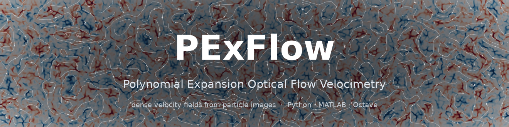
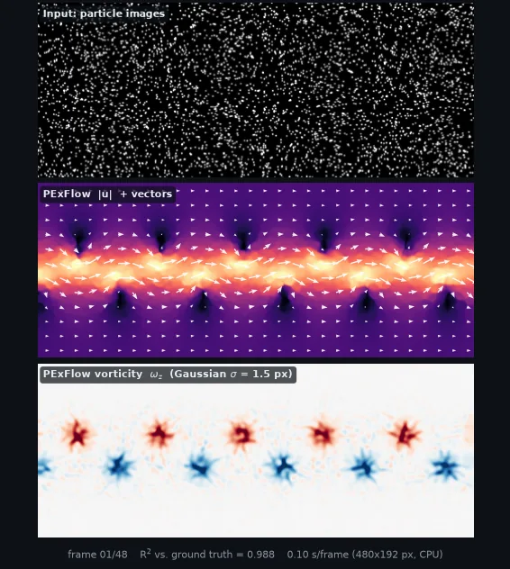
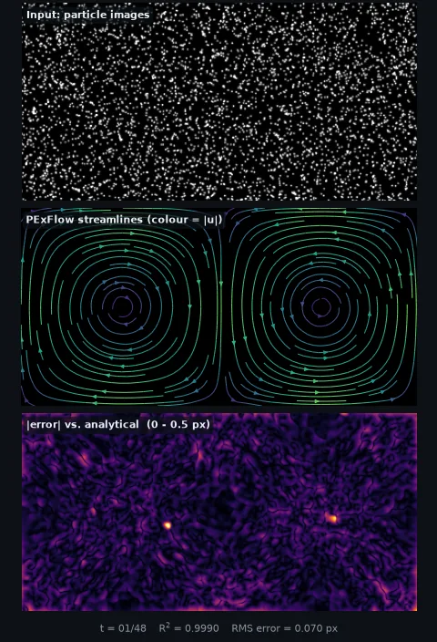
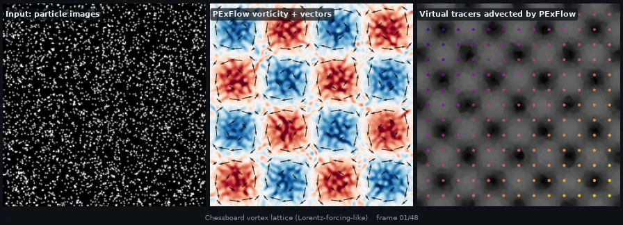
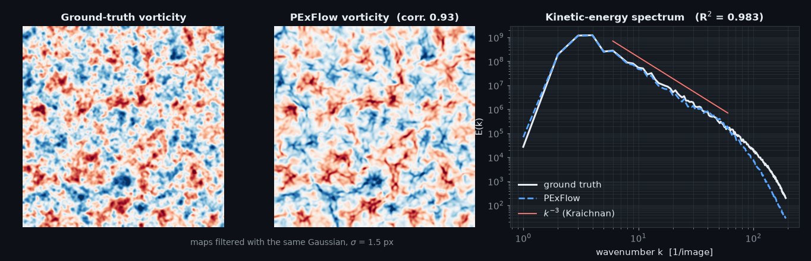
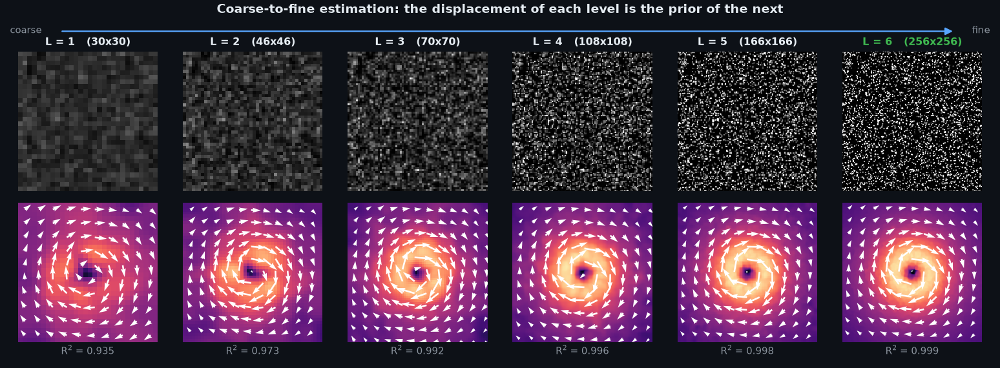
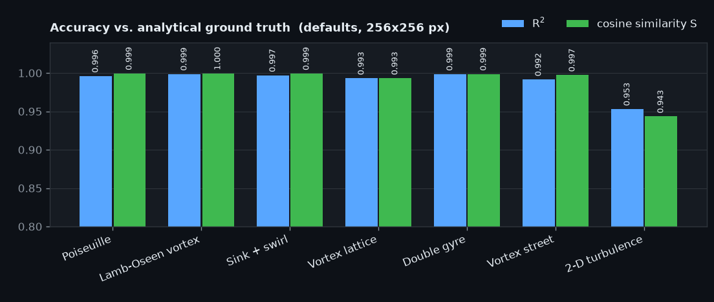
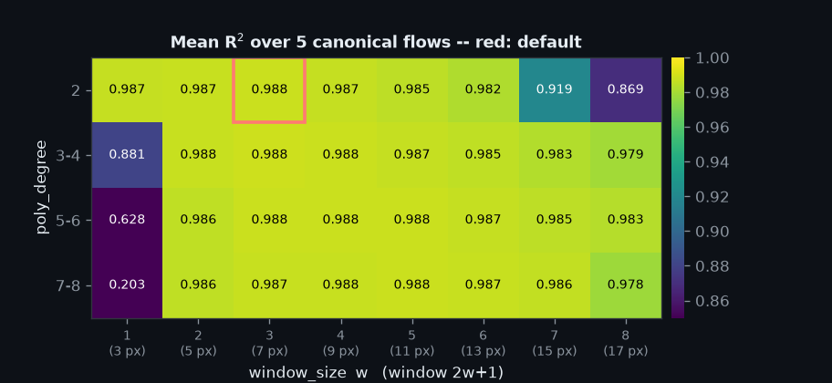
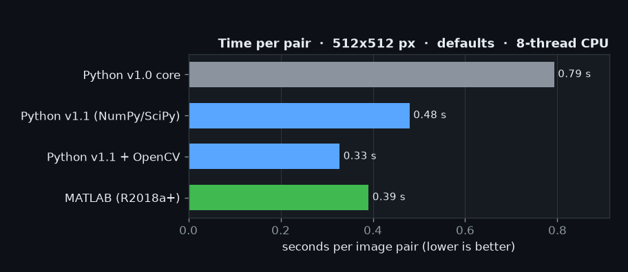

<p align="center">
  
</p>

<p align="center">
  <a href="https://doi.org/10.1007/s00348-026-04222-1"></a>
  <a href="https://github.com/Maicol-Flores-physics/PExFlow-Polynomial-Expansion-Optical-Flow-Velocimetry-/releases/latest"></a>
  
  
  
  <a href="LICENSE"></a>
  
</p>

<p align="center">
  <b><a href="#-quick-start">Quick start</a></b> ·
  <b><a href="#-how-it-works">How it works</a></b> ·
  <b><a href="#-validation">Validation</a></b> ·
  <b><a href="https://github.com/Maicol-Flores-physics/PExFlow-Polynomial-Expansion-Optical-Flow-Velocimetry-/releases/latest">Download the app</a></b> ·
  <b><a href="#-citation">Cite</a></b> ·
  <b><a href="README_es.md">Español</a></b>
</p>

**PExFlow** is an open-source, image-based method to measure **dense velocity fields in particle-laden flows**
(PIV-type images). It estimates a displacement vector **at every pixel** from a local polynomial expansion of the
image intensity, combined with a coarse-to-fine multiscale strategy and Gaussian-weighted neighbourhood integration.
It needs **no training data and no GPU**, its two main parameters have a direct physical meaning, and it is
available as a **desktop application** and as **scripts for Python, MATLAB and GNU Octave**.

<p align="center">
  
  <br><sub>Synthetic von Kármán-type vortex street. <b>Top:</b> input particle images. <b>Middle:</b> velocity magnitude and
  vectors measured by PExFlow. <b>Bottom:</b> vorticity. Mean R² against the analytical field = 0.986, default parameters.
  <a href="docs/media/hero_vortex_street.mp4">MP4</a></sub>
</p>

## ✨ Highlights

| | |
|---|---|
| **Dense** | One vector per pixel, with sub-pixel accuracy (RMS error ≈ 0.1–0.2 px on laminar canonical flows). |
| **Accurate** | Highest median R² and lowest spread among PIVlab, Horn–Schunck, Lucas–Kanade, TV-L1 and RAFT-PIV on the FLUID benchmark ([paper](https://doi.org/10.1007/s00348-026-04222-1), Table 1). |
| **Robust** | R² stays close to its optimum over almost the whole (window, degree) parameter plane. |
| **Resolves small scales** | Only method of the comparison with R² > 0.97 in the Kraichnan (k⁻³) range of an experimental 2-D turbulent flow. |
| **Fast, CPU only** | ≈ 0.3–0.5 s per 512×512 image pair on an ordinary 8-thread CPU; no GPU, no training. |
| **Easy to adopt** | Windows app with a GUI + self-contained functions for Python, MATLAB (R2018a+) and Octave (6+); Python and MATLAB give identical fields. |

## 🎛 What you can do with the application

The desktop app ([`PExFlow.exe`](https://github.com/Maicol-Flores-physics/PExFlow-Polynomial-Expansion-Optical-Flow-Velocimetry-/releases/latest), Windows 64-bit, no Python install needed) covers the whole workflow:

- **Load** single images, videos (`.mp4`, `.avi`, `.mov`, `.mkv`) or 3-D `.mat` matrices.
- **Select** the frame range and a region of interest (ROI) interactively.
- **Pre-process** (PIVlab-style): background subtraction (mean / min / max / first frame, also inverted for dark tracers), intensity capping, CLAHE, high-pass, Wiener denoising and Gaussian low-pass, with a live original-vs-processed preview.
- **Compute** PExFlow with configurable window size, polynomial degree, pyramid levels, iterations, integration σ, pyramid scale, border treatment and frame step *K*, with `dt` and the m/px calibration.
- **Visualise** in 1×1, 1×2, 2×1 or 2×2 grids: velocity magnitude, *U*/*V* components, displacement, **vorticity**, velocity angle or the original image, with a configurable **quiver** overlay and colormaps.
- **Export** an animation (video) and a `.mat` file with `U`, `V`, `x`, `y`, `t` (+ `convencion_V`: positive *V* = upwards).

> The first launch can take a few seconds. Some antivirus tools flag unsigned PyInstaller executables as a false positive. If the app does not start on another PC, install the [Visual C++ Redistributable x64](https://aka.ms/vs/17/release/vc_redist.x64.exe).

## 🖼 Gallery

<table>
<tr>
<td width="44%" align="center"><br>
<sub><b>Time-periodic double gyre.</b> Particles, PExFlow streamlines and the error against the analytical field (R² = 0.999, RMS ≈ 0.08 px). <a href="docs/media/double_gyre.mp4">MP4</a></sub></td>
<td width="56%" align="center"><br>
<sub><b>Chessboard vortex lattice</b>, like the Lorentz-forced experiment of the paper. Right: virtual tracers advected with the measured field (Lagrangian post-processing). <a href="docs/media/lorentz_lattice.mp4">MP4</a></sub>
<br><br>
<br>
<sub><b>Synthetic 2-D turbulence (E ∝ k⁻³).</b> Ground-truth vs. PExFlow vorticity and kinetic-energy spectra.</sub></td>
</tr>
</table>

## 🧠 How it works

**1 — Optical-flow hypothesis.** A particle keeps its intensity between two frames, so the second image is the first
one displaced by **d**:

$$g(\mathbf{x}) = f(\mathbf{x}-\mathbf{d})$$

**2 — Local polynomial expansion** (Farnebäck 2003, extended to arbitrary degree following Okorn & Harguess 2014).
Around every pixel the intensity is fitted, by Gaussian-weighted least squares on a $(2w+1)\times(2w+1)$ window, by a
polynomial. For degree 2:

$$f(\mathbf{x}) \simeq \mathbf{x}^\mathsf{T}\mathbf{A}_1\mathbf{x} + \mathbf{b}_1^\mathsf{T}\mathbf{x} + c_1,\qquad g(\mathbf{x}) \simeq \mathbf{x}^\mathsf{T}\mathbf{A}_2\mathbf{x} + \mathbf{b}_2^\mathsf{T}\mathbf{x} + c_2 \quad\Rightarrow\quad \mathbf{d} = -\tfrac12\,\mathbf{A}_1^{-1}(\mathbf{b}_2-\mathbf{b}_1)$$

Higher degrees add one linear equation per polynomial coefficient, giving a richer local description of the particle
pattern without any artificial regularisation term.

**3 — Gaussian neighbourhood integration.** Neighbouring pixels move alike, so the equations are accumulated over a
Gaussian neighbourhood $\omega$ (std `sigma_int`) and solved in the least-squares sense:

$$\mathbf{d}(\mathbf{x}) = \Big(\sum \omega\,\mathbf{A}^\mathsf{T}\mathbf{A}\Big)^{-1}\Big(\sum \omega\,\mathbf{A}^\mathsf{T}\Delta\mathbf{b}\Big),\qquad \mathbf{A}=\tfrac12(\mathbf{A}_1+\mathbf{A}_2),\quad \Delta\mathbf{b}=-\tfrac12(\mathbf{b}_2-\mathbf{b}_1)$$

**4 — Coarse-to-fine pyramid.** The images are repeatedly down-sampled; the displacement estimated at a coarse level is
the **prior** $\bar{\mathbf d}$ of the next finer one ($\mathbf A_2$, $\mathbf b_2$ evaluated at $\mathbf x+\bar{\mathbf d}$).
Large displacements are captured at coarse scales and refined at full resolution:

<p align="center"></p>

**5 — Borders.** Normalised convolution: outside the image the certainty is zero, so border pixels are fitted only with
real pixels, and particles that enter or leave the field of view do not corrupt the estimate.

## 🚀 Quick start

### Desktop application (Windows)

Download **`PExFlow.exe`** from the [latest release](https://github.com/Maicol-Flores-physics/PExFlow-Polynomial-Expansion-Optical-Flow-Velocimetry-/releases/latest) and double-click it. Load your video, choose frames, ROI and parameters, and press *compute*.

### Python

```bash
pip install numpy scipy opencv-python-headless   # OpenCV is optional (~1.5x faster)
```

```python
from pexflow2d import PExFlow2D, to_physical, derived_fields

est = PExFlow2D()                              # defaults of the app (w=3, degree 2, 6 levels)
dx, dy = est(frame0, frame1)                   # displacement [px]; dy > 0 = downwards
dX, dY = est.sequence(video)                   # (T-1, M, N); each frame expanded only once

U, V = to_physical(dx, dy, dt=1e-3, scale=5e-5)    # [m/s], V > 0 = upwards
F = derived_fields(U, V, h=5e-5)                   # speed, vorticity, divergence, angle
```

Command line, from a video or an image sequence:

```bash
python python/pexflow2d.py experiment.mp4 --dt 0.01 --scale 1e-4 --out flow.mat
python python/pexflow2d.py "frames/*.png" --window 3 --degree 2 --out flow.npz
```

### MATLAB (R2018a or newer, no toolboxes)

```matlab
addpath matlab
[dX, dY] = PExFlow2D(video, 3, 2, 6, 3, 2.0, 1);       % video: M x N x T
F = pexflow_fields(dX, dY, dt, scale);                  % U, V, speed, vorticity, divergence
```

See [`matlab/example_synthetic.m`](matlab/example_synthetic.m) (synthetic pair with ground truth) and
[`matlab/example_video.m`](matlab/example_video.m) (video file → `.mat` + animation).

### GNU Octave (6 or newer)

The same `PExFlow2D.m` (written in the common subset of both languages, no packages needed).

> **Note:** the Octave version shares its code with the verified MATLAB version but has not yet been tested on Octave
> itself. Please [open an issue](https://github.com/Maicol-Flores-physics/PExFlow-Polynomial-Expansion-Optical-Flow-Velocimetry-/issues) if something fails.

```bash
cd octave
octave --no-gui example_synthetic.m        # synthetic example
octave --no-gui example_images.m           # folder of images -> pexflow_result.mat
```

## ⚙️ Parameters

| Parameter | Python / MATLAB | Default | Meaning |
|---|---|---|---|
| Window | `window_size` | `3` | Radius *w* of the polynomial window (2*w*+1 px). Related to the particle-image size. |
| Degree | `poly_degree` | `2` | Degree of the local polynomial (odd → next even). Richer local intensity model. |
| Pyramid levels | `pyr_levels` | `6` | Maximum number of coarse-to-fine levels; more levels → larger displacements. |
| Iterations | `iterations` | `3` | Refinements per level. |
| Integration σ | `sigma_int` | `2.0` | Std [px] of the Gaussian neighbourhood integration. |
| Frame step | `frame_gap` / `K` | `1` | Pairs (*t*, *t*+*K*); increase for very slow flows. |
| Pyramid scale | `pyr_scale` / `'PyrScale'` | `0.65` | Scale factor between levels. |
| Border | `border` / `'Border'` | `normalized` | `normalized` (recommended) or `replicate`. |
| Precision | `precision` / `'Precision'` | `float32` / `single` | `float64` / `double` for extra precision. |

**Output convention.** `dx` (`dX`) is along the columns (+ right) and `dy` (`dY`) along the rows (+ **down**, image
convention), in pixels. Physical velocities with +*V* upwards are `U = dx·scale/dt`, `V = −dy·scale/dt`
(`to_physical` / `pexflow_fields`). The paper's average optimal set on the FLUID benchmark was window 5 px and degree 3.

## 📊 Validation

### Synthetic flows with analytical ground truth (this repository)

<p align="center"></p>

| Flow (256×256 px) | max \|**d**\| [px] | R² | Cosine similarity S | RMS error [px] |
|---|:-:|:-:|:-:|:-:|
| Poiseuille | 4.0 | 0.996 | 0.999 | 0.08 |
| Lamb–Oseen vortex | 8.0 | 0.999 | 1.000 | 0.15 |
| Sink + swirl | 5.5 | 0.997 | 0.999 | 0.11 |
| Vortex lattice | 2.5 | 0.993 | 0.993 | 0.15 |
| Double gyre | 3.1 | 0.999 | 0.999 | 0.08 |
| Vortex street | 9.1 | 0.992 | 0.997 | 0.22 |
| 2-D turbulence (k⁻³) | 4.2 | 0.953 | 0.943 | 0.36 |

All with the default parameters (mean of 3 particle realisations). Reproduce with `python examples/generate_media.py accuracy`.

### Robustness to the parameters

<p align="center"></p>

Mean R² over five canonical flows stays within ≈ 0.98–0.99 for almost every (window, degree) pair; it only drops for
a 3 px window with a high-degree polynomial (too few pixels for the fit) or very large windows (which average opposite
displacements in strong gradients). This mirrors the broad stable region reported in the paper.

### FLUID benchmark (from the paper)

R² against the analytical fields of the FLUID database ([Flores *et al.* 2026](https://doi.org/10.1007/s00348-026-04222-1), Table 1), each method with its average optimal parameters:

| Case | PIVlab | Horn–Schunck | Lucas–Kanade | TV-L1 | RAFT-PIV | **PExFlow** |
|---|:-:|:-:|:-:|:-:|:-:|:-:|
| A1b Poiseuille | 0.998 | 0.622 | 0.993 | 0.999 | **1.000** | 0.994 |
| A2b Lamb–Oseen vortex | 0.889 | 0.885 | 0.900 | 0.940 | **0.978** | 0.930 |
| A4b Sink flow | 0.848 | 0.667 | 0.621 | 0.684 | 0.612 | **0.909** |
| A5b Vortex | 0.832 | 0.665 | 0.669 | 0.725 | 0.553 | **0.956** |
| A6b Cylinder with circulation | 0.935 | 0.616 | 0.823 | 0.794 | 0.014 | **0.941** |
| A8 Shear flow | 0.947 | 0.983 | 0.969 | 0.977 | **0.997** | 0.996 |
| C1a DNS 2-D turbulence | 0.948 | 0.720 | 0.896 | 0.973 | **0.982** | 0.965 |
| **Minimum** | 0.832 | 0.616 | 0.621 | 0.684 | 0.014 | **0.909** |

On the experimental quasi-2-D turbulence generated by Lorentz forcing, all methods except Horn–Schunck recover the
Kolmogorov k⁻⁵ᐟ³ inverse cascade (R² ≈ 0.97–0.99), while in the Kraichnan k⁻³ direct cascade PExFlow reaches
**R² ≥ 0.97**, against 0.94 (RAFT-PIV), 0.91 (TV-L1) and 0.85 (PIVlab, Lucas–Kanade).

### Speed

<p align="center"></p>

The v1.1 scripts give the same fields as the v1.0 core of the application (max. difference ≈ 10⁻⁵ px) and are faster
because each frame's polynomial expansion is computed once and reused by both pairs that contain it, border operators
and resampling matrices are cached per image size, and all hot loops are vectorised. Python ↔ MATLAB results agree to
≈ 2·10⁻⁵ px. Run `python examples/benchmark.py` and `matlab/benchmark_pexflow.m` on your machine.

## 📁 Repository structure

```
├── python/
│   ├── pexflow2d.py            # PExFlow 2D (NumPy + SciPy, optional OpenCV) + CLI
│   ├── example_basic.py        # minimal example with ground truth
│   ├── requirements.txt
│   └── tests/                  # pytest suite
├── matlab/                     # MATLAB R2018a+
│   ├── PExFlow2D.m             # main function (no toolboxes)
│   ├── pexflow_fields.m        # velocity, vorticity, divergence, angle
│   ├── example_synthetic.m · example_video.m · benchmark_pexflow.m
├── octave/                     # GNU Octave 6+
│   ├── PExFlow2D.m · pexflow_fields.m
│   └── example_synthetic.m · example_images.m
├── examples/
│   ├── synthetic.py            # particle-image generator with analytical ground truth
│   ├── generate_media.py       # reproduces every figure/animation of this page
│   └── benchmark.py
└── docs/media/                 # figures, WebP animations and MP4 videos
```

## 🔁 Reproducing the figures

```bash
pip install numpy scipy matplotlib pillow imageio imageio-ffmpeg opencv-python-headless
python examples/generate_media.py          # all animations and figures (~5 min)
python -m pytest python/tests              # tests
```

## 📖 Citation

If PExFlow is useful for your research, please cite:

```bibtex
@article{Flores2026PExFlow,
  title   = {Optical flow method based on polynomial expansion for particle-laden fluid velocimetry},
  author  = {Flores, M. and Rinderknecht, F. and Gallot, T. and Sarasua, L. G. and
             Abraham, Y. and Barrere, N. and Freire Caporale, D.},
  journal = {Experiments in Fluids},
  volume  = {67},
  pages   = {72},
  year    = {2026},
  doi     = {10.1007/s00348-026-04222-1}
}
```

## 👥 Authors & acknowledgements

**Maicol Flores**, F. Rinderknecht, T. Gallot, L. G. Sarasua, Y. Abraham, N. Barrere and D. Freire Caporale —
Instituto de Física, Facultad de Ciencias, Universidad de la República, Montevideo, Uruguay.
Questions and bug reports: please open an [issue](https://github.com/Maicol-Flores-physics/PExFlow-Polynomial-Expansion-Optical-Flow-Velocimetry-/issues).

Financial support: Agencia Nacional de Investigación e Innovación (ANII, Uruguay), POS-NAC-2024-1-183447.
Synthetic benchmark images: FLUID project (Prof. Étienne Mémin, <http://www.fluid.irisa.fr/>).

## 📜 License

Released under the [MIT License](LICENSE).

**References.** G. Farnebäck (2003), *Two-frame motion estimation based on polynomial expansion*, SCIA ·
B. Okorn & J. Harguess (2014), *Ego-motion estimation on range images using high-order polynomial expansion*, CVPRW.
