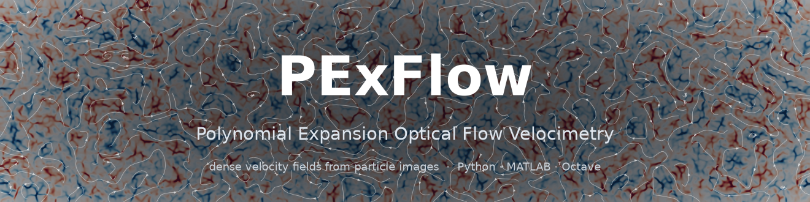
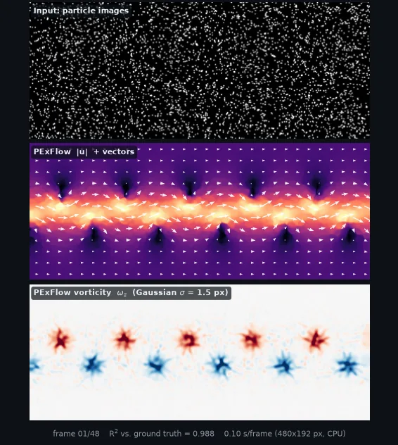
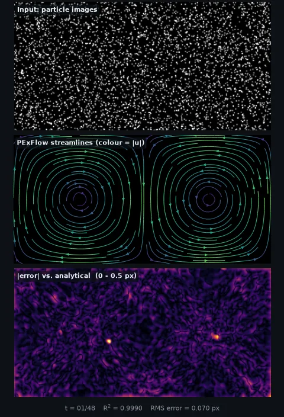
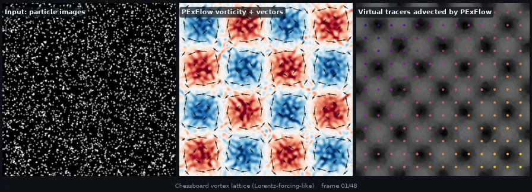
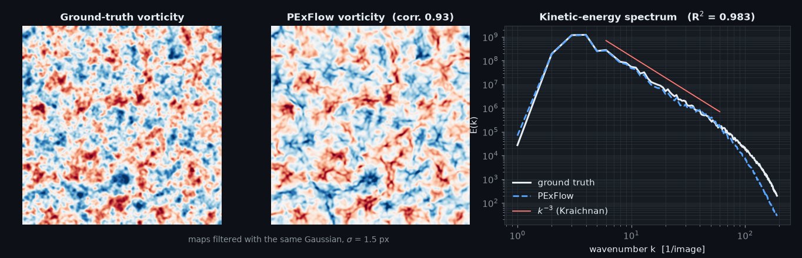
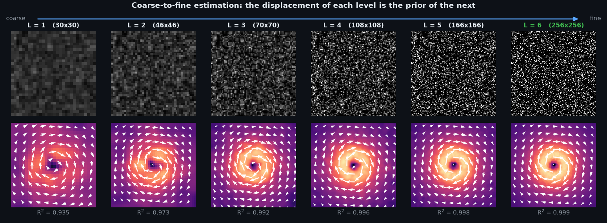
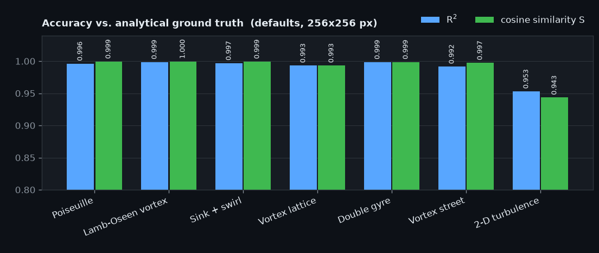
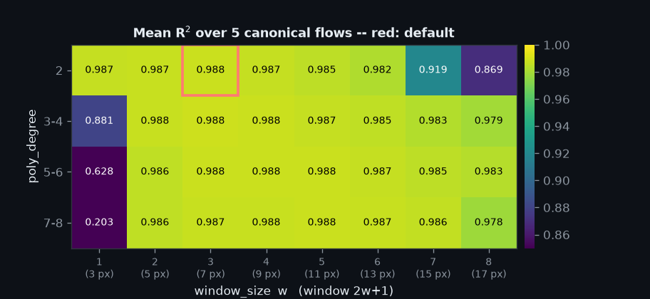
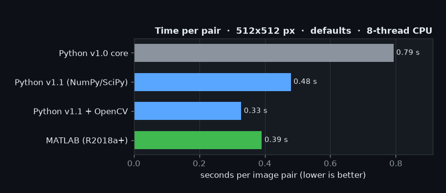

<p align="center">
  
</p>

<p align="center">
  <b><a href="#-inicio-rápido">Inicio rápido</a></b> ·
  <b><a href="#-cómo-funciona">Cómo funciona</a></b> ·
  <b><a href="#-validación">Validación</a></b> ·
  <b><a href="https://github.com/Maicol-Flores-physics/PExFlow-Polynomial-Expansion-Optical-Flow-Velocimetry-/releases/latest">Descargar la aplicación</a></b> ·
  <b><a href="#-cómo-citar">Citar</a></b> ·
  <b><a href="README.md">English</a></b>
</p>

**PExFlow** (*Polynomial Expansion Optical Flow Velocimetry*) es un método de código abierto para medir **campos de
velocidad densos en flujos con partículas** (imágenes tipo PIV). Estima un vector de desplazamiento **en cada píxel**
a partir de una expansión polinómica local de la intensidad, combinada con una estrategia multiescala *coarse-to-fine*
y una integración gaussiana en el vecindario. **No requiere datos de entrenamiento ni GPU**, sus dos parámetros
principales tienen significado físico directo, y está disponible como **aplicación de escritorio** y como **scripts
para Python, MATLAB y GNU Octave**.

<p align="center">
  
  <br><sub>Calle de vórtices sintética tipo von Kármán. <b>Arriba:</b> imágenes de partículas de entrada. <b>Centro:</b>
  módulo de la velocidad y vectores medidos con PExFlow. <b>Abajo:</b> vorticidad. R² medio frente al campo analítico = 0.986,
  parámetros por defecto. <a href="docs/media/hero_vortex_street.mp4">MP4</a></sub>
</p>

## ✨ Puntos fuertes

| | |
|---|---|
| **Denso** | Un vector por píxel con precisión sub-píxel (error RMS ≈ 0.1–0.2 px en flujos laminares canónicos). |
| **Preciso** | Mayor mediana de R² y menor dispersión frente a PIVlab, Horn–Schunck, Lucas–Kanade, TV-L1 y RAFT-PIV en la base FLUID ([artículo](https://doi.org/10.1007/s00348-026-04222-1), Tabla 1). |
| **Robusto** | El R² se mantiene cerca del óptimo en casi todo el plano de parámetros (ventana, grado). |
| **Resuelve escalas pequeñas** | Único método de la comparación con R² > 0.97 en el rango de Kraichnan (k⁻³) de una turbulencia 2-D experimental. |
| **Rápido, solo CPU** | ≈ 0.3–0.5 s por par de 512×512 en una CPU común de 8 hilos; sin GPU ni entrenamiento. |
| **Fácil de usar** | Aplicación para Windows con interfaz gráfica + funciones autocontenidas para Python, MATLAB (R2018a+) y Octave (6+); Python y MATLAB dan campos idénticos. |

## 🎛 Qué permite hacer la aplicación

La aplicación ([`PExFlow.exe`](https://github.com/Maicol-Flores-physics/PExFlow-Polynomial-Expansion-Optical-Flow-Velocimetry-/releases/latest), Windows 64 bits, no requiere instalar Python) cubre todo el flujo de trabajo:

- **Cargar** imágenes, videos (`.mp4`, `.avi`, `.mov`, `.mkv`) o matrices 3-D `.mat`.
- **Seleccionar** el rango de frames y la región de interés (ROI) de forma interactiva.
- **Pre-procesar** (estilo PIVlab): resta de fondo (promedio / mínimo / máximo / primer frame, también invertida para trazadores oscuros), *intensity capping*, CLAHE, filtro pasa-altos, filtro de Wiener y pasa-bajos gaussiano, con vista previa original vs. procesada.
- **Calcular** PExFlow con ventana, grado del polinomio, niveles de pirámide, iteraciones, σ de integración, escala de pirámide, tratamiento de bordes y paso entre frames *K*, junto con `dt` y la calibración en m/px.
- **Visualizar** en grillas 1×1, 1×2, 2×1 o 2×2: módulo de la velocidad, componentes *U*/*V*, desplazamiento, **vorticidad**, ángulo o imagen original, con vectores (**quiver**) y mapas de color configurables.
- **Exportar** una animación (video) y un `.mat` con `U`, `V`, `x`, `y`, `t` (+ `convencion_V`: *V* positivo = hacia arriba).

> El primer arranque puede demorar unos segundos. Algunos antivirus marcan como falso positivo los ejecutables de PyInstaller sin firmar. Si no abre en otra PC, instale el [Visual C++ Redistributable x64](https://aka.ms/vs/17/release/vc_redist.x64.exe).

## 🖼 Galería

<table>
<tr>
<td width="44%" align="center"><br>
<sub><b>Doble giro periódico en el tiempo.</b> Partículas, líneas de corriente medidas con PExFlow y error frente al campo analítico (R² = 0.999, RMS ≈ 0.08 px). <a href="docs/media/double_gyre.mp4">MP4</a></sub></td>
<td width="56%" align="center"><br>
<sub><b>Red de vórtices en tablero de ajedrez</b>, como el experimento con forzado de Lorentz del artículo. Derecha: trazadores virtuales advectados con el campo medido (post-procesamiento lagrangiano). <a href="docs/media/lorentz_lattice.mp4">MP4</a></sub>
<br><br>
<br>
<sub><b>Turbulencia 2-D sintética (E ∝ k⁻³).</b> Vorticidad real vs. PExFlow y espectros de energía cinética.</sub></td>
</tr>
</table>

## 🧠 Cómo funciona

**1 — Hipótesis de flujo óptico.** Una partícula conserva su intensidad entre dos frames, por lo que la segunda imagen
es la primera desplazada **d**:

$$g(\mathbf{x}) = f(\mathbf{x}-\mathbf{d})$$

**2 — Expansión polinómica local** (Farnebäck 2003, extendida a grado arbitrario según Okorn & Harguess 2014). En torno a
cada píxel se ajusta la intensidad, por mínimos cuadrados ponderados en una ventana de $(2w+1)\times(2w+1)$, con un
polinomio. Para grado 2:

$$f(\mathbf{x}) \simeq \mathbf{x}^\mathsf{T}\mathbf{A}_1\mathbf{x} + \mathbf{b}_1^\mathsf{T}\mathbf{x} + c_1,\qquad g(\mathbf{x}) \simeq \mathbf{x}^\mathsf{T}\mathbf{A}_2\mathbf{x} + \mathbf{b}_2^\mathsf{T}\mathbf{x} + c_2 \quad\Rightarrow\quad \mathbf{d} = -\tfrac12\,\mathbf{A}_1^{-1}(\mathbf{b}_2-\mathbf{b}_1)$$

Los grados mayores agregan una ecuación lineal por coeficiente, lo que da una descripción local más rica del patrón de
partículas sin términos de regularización artificiales.

**3 — Integración gaussiana en el vecindario.** Los píxeles vecinos se mueven de forma parecida: las ecuaciones se
acumulan con un peso gaussiano $\omega$ (desviación `sigma_int`) y se resuelven por mínimos cuadrados:

$$\mathbf{d}(\mathbf{x}) = \Big(\sum \omega\,\mathbf{A}^\mathsf{T}\mathbf{A}\Big)^{-1}\Big(\sum \omega\,\mathbf{A}^\mathsf{T}\Delta\mathbf{b}\Big),\qquad \mathbf{A}=\tfrac12(\mathbf{A}_1+\mathbf{A}_2),\quad \Delta\mathbf{b}=-\tfrac12(\mathbf{b}_2-\mathbf{b}_1)$$

**4 — Pirámide *coarse-to-fine*.** Las imágenes se submuestrean sucesivamente; el desplazamiento estimado en un nivel
grueso es el ***prior*** $\bar{\mathbf d}$ del siguiente nivel más fino ($\mathbf A_2$, $\mathbf b_2$ evaluados en
$\mathbf x+\bar{\mathbf d}$). Los desplazamientos grandes se capturan en escalas gruesas y se refinan a resolución completa:

<p align="center"></p>

**5 — Bordes.** Convolución normalizada: fuera de la imagen la certeza es cero, así que los píxeles del borde se ajustan
solo con píxeles reales, y las partículas que entran o salen del campo no contaminan la estimación.

## 🚀 Inicio rápido

### Aplicación de escritorio (Windows)

Descargue **`PExFlow.exe`** de la [última release](https://github.com/Maicol-Flores-physics/PExFlow-Polynomial-Expansion-Optical-Flow-Velocimetry-/releases/latest) y ábralo con doble clic. Cargue el video, elija frames, ROI y parámetros, y calcule.

### Python

```bash
pip install numpy scipy opencv-python-headless   # OpenCV es opcional (~1.5x más rápido)
```

```python
from pexflow2d import PExFlow2D, to_physical, derived_fields

est = PExFlow2D()                              # valores por defecto de la app (w=3, grado 2, 6 niveles)
dx, dy = est(frame0, frame1)                   # desplazamiento [px]; dy > 0 = hacia abajo
dX, dY = est.sequence(video)                   # (T-1, M, N); cada frame se expande una sola vez

U, V = to_physical(dx, dy, dt=1e-3, scale=5e-5)    # [m/s], V > 0 = hacia arriba
F = derived_fields(U, V, h=5e-5)                   # módulo, vorticidad, divergencia, ángulo
```

Desde la línea de comandos, con un video o una secuencia de imágenes:

```bash
python python/pexflow2d.py experimento.mp4 --dt 0.01 --scale 1e-4 --out flujo.mat
python python/pexflow2d.py "frames/*.png" --window 3 --degree 2 --out flujo.npz
```

### MATLAB (R2018a o posterior, sin toolboxes)

```matlab
addpath matlab
[dX, dY] = PExFlow2D(video, 3, 2, 6, 3, 2.0, 1);       % video: M x N x T
F = pexflow_fields(dX, dY, dt, scale);                  % U, V, módulo, vorticidad, divergencia
```

Ver [`matlab/example_synthetic.m`](matlab/example_synthetic.m) (par sintético con solución exacta) y
[`matlab/example_video.m`](matlab/example_video.m) (video → `.mat` + animación).

### GNU Octave (6 o posterior)

El mismo `PExFlow2D.m` (escrito en el subconjunto común de ambos lenguajes, sin paquetes adicionales).

> **Nota:** la versión de Octave comparte el código con la versión de MATLAB ya verificada, pero todavía no fue probada
> en Octave. Si algo falla, por favor [abra un issue](https://github.com/Maicol-Flores-physics/PExFlow-Polynomial-Expansion-Optical-Flow-Velocimetry-/issues).

```bash
cd octave
octave --no-gui example_synthetic.m        # ejemplo sintético
octave --no-gui example_images.m           # carpeta de imágenes -> pexflow_result.mat
```

## ⚙️ Parámetros

| Parámetro | Python / MATLAB | Por defecto | Significado |
|---|---|---|---|
| Ventana | `window_size` | `3` | Radio *w* de la ventana polinómica (2*w*+1 px). Relacionado con el tamaño de la imagen de partícula. |
| Grado | `poly_degree` | `2` | Grado del polinomio local (impar → par siguiente). Modelo local de intensidad más rico. |
| Niveles de pirámide | `pyr_levels` | `6` | Número máximo de niveles; más niveles → desplazamientos mayores. |
| Iteraciones | `iterations` | `3` | Refinamientos por nivel. |
| σ de integración | `sigma_int` | `2.0` | Desviación [px] de la integración gaussiana. |
| Paso entre frames | `frame_gap` / `K` | `1` | Pares (*t*, *t*+*K*); aumentar para flujos muy lentos. |
| Escala de pirámide | `pyr_scale` / `'PyrScale'` | `0.65` | Factor de escala entre niveles. |
| Borde | `border` / `'Border'` | `normalized` | `normalized` (recomendado) o `replicate`. |
| Precisión | `precision` / `'Precision'` | `float32` / `single` | `float64` / `double` para mayor precisión. |

**Convención de salida.** `dx` (`dX`) va según las columnas (+ derecha) y `dy` (`dY`) según las filas (+ **abajo**,
convención de imagen), en píxeles. Las velocidades físicas con +*V* hacia arriba son `U = dx·scale/dt`,
`V = −dy·scale/dt` (`to_physical` / `pexflow_fields`). En el artículo, el conjunto óptimo promedio sobre la base FLUID
fue ventana de 5 px y grado 3.

## 📊 Validación

### Flujos sintéticos con solución analítica (este repositorio)

<p align="center"></p>

| Flujo (256×256 px) | máx \|**d**\| [px] | R² | Similitud coseno S | Error RMS [px] |
|---|:-:|:-:|:-:|:-:|
| Poiseuille | 4.0 | 0.996 | 0.999 | 0.08 |
| Vórtice de Lamb–Oseen | 8.0 | 0.999 | 1.000 | 0.15 |
| Sumidero + giro | 5.5 | 0.997 | 0.999 | 0.11 |
| Red de vórtices | 2.5 | 0.993 | 0.993 | 0.15 |
| Doble giro | 3.1 | 0.999 | 0.999 | 0.08 |
| Calle de vórtices | 9.1 | 0.992 | 0.997 | 0.22 |
| Turbulencia 2-D (k⁻³) | 4.2 | 0.953 | 0.943 | 0.36 |

Todos con los parámetros por defecto (promedio de 3 realizaciones). Se reproduce con `python examples/generate_media.py accuracy`.

### Robustez frente a los parámetros

<p align="center"></p>

El R² medio sobre cinco flujos canónicos se mantiene en ≈ 0.98–0.99 para casi cualquier par (ventana, grado); solo cae
con ventanas de 3 px y polinomios de grado alto (muy pocos píxeles para el ajuste) o ventanas muy grandes (que promedian
desplazamientos opuestos en gradientes fuertes), en línea con la amplia región estable reportada en el artículo.

### Base FLUID (del artículo)

R² frente a los campos analíticos de la base FLUID ([Flores *et al.* 2026](https://doi.org/10.1007/s00348-026-04222-1), Tabla 1), cada método con sus parámetros óptimos promedio:

| Caso | PIVlab | Horn–Schunck | Lucas–Kanade | TV-L1 | RAFT-PIV | **PExFlow** |
|---|:-:|:-:|:-:|:-:|:-:|:-:|
| A1b Poiseuille | 0.998 | 0.622 | 0.993 | 0.999 | **1.000** | 0.994 |
| A2b Vórtice de Lamb–Oseen | 0.889 | 0.885 | 0.900 | 0.940 | **0.978** | 0.930 |
| A4b Sumidero | 0.848 | 0.667 | 0.621 | 0.684 | 0.612 | **0.909** |
| A5b Vórtice | 0.832 | 0.665 | 0.669 | 0.725 | 0.553 | **0.956** |
| A6b Cilindro con circulación | 0.935 | 0.616 | 0.823 | 0.794 | 0.014 | **0.941** |
| A8 Flujo de corte | 0.947 | 0.983 | 0.969 | 0.977 | **0.997** | 0.996 |
| C1a DNS turbulencia 2-D | 0.948 | 0.720 | 0.896 | 0.973 | **0.982** | 0.965 |
| **Mínimo** | 0.832 | 0.616 | 0.621 | 0.684 | 0.014 | **0.909** |

En la turbulencia cuasi-2-D experimental generada por forzado de Lorentz, todos los métodos salvo Horn–Schunck recuperan
la cascada inversa de Kolmogorov k⁻⁵ᐟ³ (R² ≈ 0.97–0.99), mientras que en la cascada directa de Kraichnan k⁻³ PExFlow
alcanza **R² ≥ 0.97**, frente a 0.94 (RAFT-PIV), 0.91 (TV-L1) y 0.85 (PIVlab, Lucas–Kanade).

### Velocidad de cálculo

<p align="center"></p>

Los scripts v1.1 dan los mismos campos que el núcleo v1.0 de la aplicación (diferencia máxima ≈ 10⁻⁵ px) y son más
rápidos porque la expansión polinómica de cada frame se calcula una sola vez y la reutilizan los dos pares que lo
contienen, los operadores de borde y las matrices de remuestreo se guardan por tamaño de imagen, y los bucles críticos
están vectorizados. Python y MATLAB coinciden a ≈ 2·10⁻⁵ px.

## 📖 Cómo citar

```bibtex
@article{Flores2026PExFlow,
  title   = {Optical flow method based on polynomial expansion for particle-laden fluid velocimetry},
  author  = {Flores, M. and Rinderknecht, F. and Gallot, T. and Sarasua, L. G. and
             Abraham, Y. and Barrere, N. and Freire Caporale, D.},
  journal = {Experiments in Fluids},
  volume  = {67},
  pages   = {72},
  year    = {2026},
  doi     = {10.1007/s00348-026-04222-1}
}
```

## 👥 Autores y agradecimientos

**Maicol Flores**, F. Rinderknecht, T. Gallot, L. G. Sarasua, Y. Abraham, N. Barrere y D. Freire Caporale —
Instituto de Física, Facultad de Ciencias, Universidad de la República, Montevideo, Uruguay.
Consultas y reportes de errores: abra un [issue](https://github.com/Maicol-Flores-physics/PExFlow-Polynomial-Expansion-Optical-Flow-Velocimetry-/issues).

Financiación: Agencia Nacional de Investigación e Innovación (ANII, Uruguay), POS-NAC-2024-1-183447.
Imágenes sintéticas de referencia: proyecto FLUID (Prof. Étienne Mémin, <http://www.fluid.irisa.fr/>).

## 📜 Licencia

Distribuido bajo la [licencia MIT](LICENSE).
